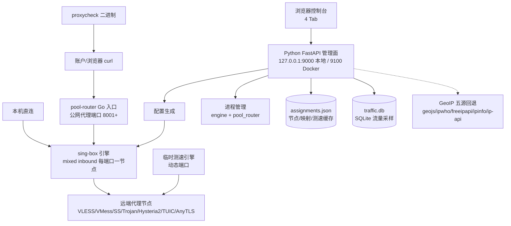

# 系统架构全景 (Architecture Overview)

> 真理源：`requirements.txt` / `Dockerfile` / `app/` / `proxycheck-api/go.mod` / `config/app.json`（2026-09-05 核验）。
> 历史设计（2026-06-04）与审计（2026-07-21）已移入 `docs/archive/`（本地专用），与本文冲突时以本文 + 代码为准。

## 1. 系统全景

核心原则：**Python 永不在正式数据路径上**。代理流量只走 `pool-router（Go）→ sing-box（Go）→ 远端节点`。
Python 只做导入解析、配置生成、进程启停、状态聚合、Web 管理。测速/出口查询是 Python 主动发起的探测流量，不是业务流量。

## 2. 模块划分与依赖边界

- **`main.py`**：唯一入口。`create_app()` + `uvicorn.run`，默认单 worker。禁止加 `--workers`（状态/Job/会话/进程句柄全在进程内）。
- **`app/api.py`**（组合根）：装配 `create_app()`、全部 REST 路由、后台循环（订阅刷新 / 定时清理 / 流量采样 / 引擎与路由自愈）、防抖落盘。路由只读 `app_state` + 调模块函数，禁止在路由里拼 sing-box JSON。
- **`app/settings.py`**：唯一配置源。路径常量（`config/` / `bin/` / `templates/` / `static/`）+ 读取优先级 `环境变量 > config/app.json > 代码默认`。`host/port` 需重启 Web 生效；`proxy_listen_host` / `clash_api_addr` / `domain_resolve_strategy` 在下次生成配置时生效（运行时读取函数）。
- **`app/parser.py`**：订阅/文本 → sing-box outbound 列表。支持 Clash YAML / Base64 订阅 / 单链接。坏行跳过 + warnings，绝不因一条坏链接丢掉整批。订阅下载流式限长 32MB（按解压后字节计），私网地址拦截覆盖重定向每一跳。
- **`app/generator.py`**：纯函数，`AppState` → `sing-box.json` / `pool-router.json`。每个映射端口一个 `mixed` inbound + 一条 route rule；池内部分配 `18000+` 内部端口并避开已用端口。禁止在此启动进程。
- **`app/engine.py` / `app/pool_router.py`**：唯一能 spawn/kill 子进程的模块。启动前必 `sing-box check`，启动后等端口就绪（最多约 8 秒）。进程归属按命令行中的配置文件路径判定，禁止按二进制路径粗暴匹配（曾误杀主引擎）。
- **`app/tester.py` / `app/proxy_check.py`**：探测面。节点测速用临时引擎 + 动态空闲端口（不再固定 `19001`）；端口验证走已运行引擎；`proxycheck` 二进制做本地质量检测。测速与正式引擎禁止并发互踩（正式启动时测速运行中返回 409）。
- **`app/traffic.py`**：`traffic.db` 累计计数器采样（约 15 秒），只存增量聚合，不存请求内容。router 重启后首个窗口少计属已知取舍。超过 35 天的桶/事件由流量采样循环每小时清理。
- **`app/geoip.py`**：出口 IP 地理缓存，失败 1 小时重试，后台信号量限流。过期条目由任务清理循环每小时淘汰，避免状态文件无限膨胀。
- **`app/store.py`**：`assignments.json` 原子落盘（tmp + replace），损坏自动备份（`assignments.json.bak-*`），加载失败永不丢弃内存中的可用状态。
- **`app/models.py` / `app/schemas.py`**：数据模型与请求/Job 模型。金额式“禁止裸类型”类规则在此层收敛校验（端口范围、保留端口、tag 存在性）。
- **`app/jobs.py`**：三类后台 Job（节点测速 / 端口验证 / 本地检测），带保留时长与上限，超时清理。
- **`app/httpclient.py`**：共享 httpx SSL 上下文（Windows 证书库加载阻塞事件循环，禁止每请求新建 client）。
- **`app/utils.py`**：无 `create_app()` 闭包依赖的纯工具（端口探测、doctor 命令、默认验证 URL）。
- **`app/routes/auth.py`**：`admin_key`（`config/app.json` 或 `PPM_ADMIN_KEY`）为空即无鉴权；会话 8 小时 TTL，5 次失败锁定 60 秒。
- **前端（`templates/index.html` + `static/`，无构建）**：4 Tab（`monitor` / `test` / `assign` / `dashboard`，`import` 已并入 test）。`app.js` 引用的 DOM id / `data-tab` / `/api/*` 路径由 `tests/test_frontend_contract.py` 锁定，改 UI 必先跑它。
- **Go（`proxycheck-api/`）**：`proxycheck`（质量检测）与 `pool-router`（公网入口：普通/加权轮询、排空、拨号失败跳过）。`Dockerfile` 用 `golang:1.22` 构建，`go.mod` 声明 `go 1.21`。
- **`proxy-port-api/`**：独立 Node TS 辅助，仅 `scan` 脚本，非运行时依赖，不要把它的依赖并入 Python 运行时。

依赖方向只允许：`Web → API →（parser/generator/engine/tester/traffic/store）→ 二进制/文件`。禁止反向：前端直读 `config/`、generator 启动进程、tester 写正式配置。

## 3. 关键数据流向

- **导入**：`POST /api/import {url|text}` → `parser.import_nodes`（重定向跟随 + 浏览器 UA）→ 去重（`server:port:credential` + 变体指纹后缀）→ `save_later()` 防抖落盘。
- **测速**：`POST /api/test/start` → 建 Job → 临时引擎（预检隔离坏配置）→ 逐节点 HTTP 延迟（默认 gstatic 204，可自定义单 URL）→ 每完成一个即写 Job + 排序（可用优先、延迟升序、失败随后）→ 可选按出口 IP 去重（只保留同 IP 最快）。
- **分配**：`PUT /api/assign` → 校验（1024–65535、tag 存在、保留端口：Web/Clash-API/pool-router 控制口不可占）→ 保存 → 运行中则全量重启引擎 + 路由（已知取舍：会断开所有端口活动连接）。
- **启动**：`POST /api/start` → `generate_config` → `sing-box check` → `stop` 旧进程 → `start` → 等 `runtime_ports()` 全部监听 → 返回 `expected/listening/ready`。
- **状态**：`GET /api/status` 永不做阻塞式全端口扫描；监听集合由后台循环每 5 秒刷新，前端每 15 秒轮询（页面不可见暂停）。
- **验证**：`POST /api/test-ports/start` → 逐端口 `validate_proxy_targets`（默认 webshare + google/gstatic + cloudflare，或单一自定义 URL）→ 出口 IP 提取 → GeoIP 富化 → 写 `latency_cache` / `exit_ip_cache`。
- **流量**：router telemetry（15 秒）→ `traffic_store.sample` 按 `listener:` / `backend:` 聚合 → 按端口/池/节点查询。
- **订阅**：后台 15 秒 tick，多源独立计时，到期自动刷新并重建对应节点组。

## 4. 核心抽象与设计模式

- **一端口一节点**：`port_mappings: {port: {node_tag}}` + `pools: [{listen_port, members, weights}]`，持久化于 `assignments.json`（`version` + `updated_at`）。
- **双模式运行**：router 可用时公网流量走 `pool-router`（`proxy_listen_host:8001+`），`sing-box` 退为内部出站层；router 不可用时 `sing-box` 直接监听代理端口。`config_matches_state`（生成配置端口 vs 内存期望端口）用于发现测试污染或外部改动。
- **Job 轮询**：长任务（测速/验证/检测）一律 `POST .../start → {job_id}` + `GET .../jobs/{id}` 渐进返回，前端逐条渲染，禁止等全量。
- **保留端口**：Web 端口 + Clash API 端口 + pool-router 控制口永不可分配；`POST /api/ports/check` 与保存校验共用同一 `reserved_ports()`。
- **错误风格**：API 返回 `{detail}` 或结构化 `{ok, error, targets[]}`，禁止抛裸异常穿透为 500（订阅下载失败已转译）。

## 5. 外部依赖与集成点

- sing-box releases（`SagerNet/sing-box`，默认 `1.13.13`）：引擎 + `check` 校验 + Clash API（`experimental.clash_api`）。
- GeoIP 五源：`geojs → ipwho → freeipapi → ipinfo → ip-api`，失败项 1 小时后重试。
- 出口/验证目标：`ipv4.webshare.io` / `api.ipify.org` / `google/gstatic generate_204` / `cloudflare trace`，均可被自定义 URL 替代（单 URL 模式不混入默认目标）。
- 部署：`Dockerfile`（`python:3.12-slim` + Go 构建 + sing-box 下载）与 `docker-compose.yml`（控制台 `127.0.0.1:9100`，代理段 `8001-8300` 按需公开，反代示例见 `docs/operation.md`）。

## 6. 技术债务与已知取舍

- 2026-09-05 实测 1 项失败：`test_engine_start_stop_is_one_accessible_switch`（JS 已演进为 `needsRecovery || !running`，测试字符串未同步）。功能契约（单开关/`role=switch`）仍成立，判为测试过时而非功能回归，修测试不断言 exact 字符串即可（但本次只整理文档，不改代码）。
- 代理端口无认证的开放代理：`mixed` inbound 无 `users`，`0.0.0.0` 监听时必须靠防火墙/安全组/IP 白名单限制，禁止直接裸露公网。
- 本地 `config/app.json` 当前无 `admin_key` 且 `host=127.0.0.1`：本机安全，任何向局域网/公网暴露控制台的行为必须先设强 `admin_key`（或 `PPM_ADMIN_KEY`）。
- 任何映射/池变更全量重启：实现简单但掐断所有活动连接，与“稳定出口”目标冲突，热加载待评估。
- sing-box 严格 JSON 解码：未知字段即整份配置失败。历史教训（Reality `spider_x`、TUIC `heartbeat` 裸数字）已在解析层清洗，新增协议字段必须先过 `sing-box check` 实测。
- 端口可用性检测有 TOCTOU（检测→关闭→启动窗口），启动前等待 + 明确报错为当前缓解，非根治。
